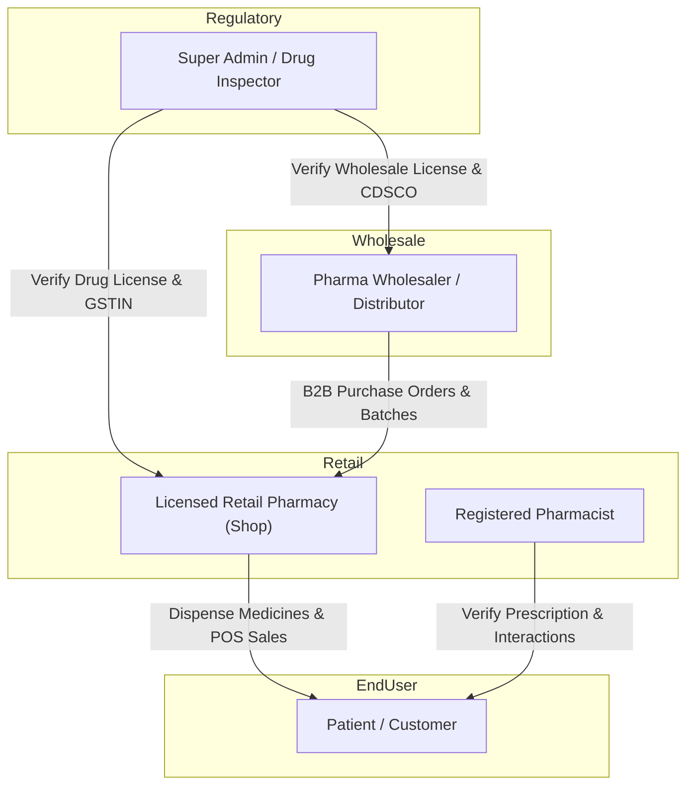
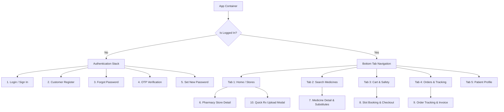

# Medical SaaS Mobile Application — Complete Architectural Blueprint & Specifications

> **System Overview**: Enterprise Medical SaaS & Digital Pharmacy Commerce Platform connecting Patients/Customers, Licensed Retail Pharmacies, Pharmaceutical Distributors/Vendors, and Regulators based on `Medical_backend/` and `medical_frontend/`.

---

## 1. Core Vision & Distinction: Medical SaaS vs. Quick Commerce Food Apps

| Dimension | Food / Delivery Apps (Swiggy / Zomato) | Medical SaaS Mobile Platform (Our App) |
| :--- | :--- | :--- |
| **Tone & Imagery** | Playful, colorful, appetite-driven ("Namaste", food photos, cartoon delivery bikes) | **Sterile, authoritative, clinical, calm, and reassuring** (Clean teal, soft slate, white space) |
| **Search Priority** | Cuisines, restaurants, fast dishes | **Active Salt/Composition, Brand Name, Generic vs. Branded Cost Comparison, Dosage Form (Tablet/Syrup/Injection)** |
| **Safety Guardrails** | None (add anything to cart) | **Drug-Drug Interaction Warnings (`SEVERE` vs `MODERATE`), Schedule H/H1/X Rx Gates, Pharmacist Review** |
| **Inventory Model** | Unregulated kitchen items | **Licensed Pharmacy Batches, Expiry Dates, Batch Numbers, FEFO (First Expiry First Out), Drug Licenses** |
| **Compliance** | Simple invoice | **GST Compliant B2B/B2C Medical Invoices, Doctor Prescriptions attached to Order ID, Regulated Pickup/Delivery** |

---

## 2. Multi-Actor Ecosystem Architecture (From `Medical_backend/`)

The platform connects 4 actors across the pharmaceutical supply chain:

### Detailed Actor Roles:

#### A. Patient / End Customer (`CUSTOMER`)
- Discover verified licensed pharmacies nearby based on geo-location (latitude, longitude, radius).
- Search medicines by **Brand Name** or **Salt / Chemical Composition**.
- Compare branded medicines with **generic cost-saving substitutes** (up to 80% price reduction).
- Automated **Clinical Safety Engine**: Live checks for adverse Drug-Drug Interactions across all cart items.
- Upload Doctor Prescriptions (JPEG/PNG/PDF) for Schedule H/X drugs.
- Choose between **In-Store Pickup** (slot scheduling) or **Home Delivery**.
- Live Order Lifecycle Tracking (`PLACED` ➔ `CONFIRMED` ➔ `PREPARING` ➔ `READY_FOR_PICKUP` / `OUT_FOR_DELIVERY` ➔ `COMPLETED`).

#### B. Retail Pharmacy & Staff (`RETAILER`, `RETAILER_STAFF`)
- **POS Counter Billing**: Fast offline/online counter checkout with barcode scanning, auto-batch selection (FEFO), and thermal receipt printing.
- **Order Queue & Fulfillment**: Real-time incoming customer order dashboard with prescription viewer (Approve / Reject with clinical reason).
- **Inventory & Batch Tracking**: Stock levels, batch numbers, MRP vs Purchase Rate, expiry alerts (30, 60, 90 days).
- **B2B Procurement**: Create Purchase Orders (POs) directly to pharmaceutical distributors, receive GRN (Goods Received Note), and auto-update inventory.

#### C. Pharmaceutical Distributor (`VENDOR`)
- Manage B2B purchase orders from retail pharmacies.
- Partial and full dispatches, batch allocation, credit limit enforcement, and GST B2B tax invoicing.

#### D. Regulatory Admin (`ADMIN`)
- KYC verification of pharmacy licenses (Form 20/21), GST certificates, master medicine database management, and dispute mediation.

---

## 3. Customer Mobile App — Full Screen Inventory & Navigation Architecture

### Screen Inventory & Responsibilities:

| # | Screen Name | Route / Key | Primary Functionality & Components |
|---|---|---|---|
| **1** | **Sign In** | `login` | Mobile number / Email + Password, Demo Quick-fill buttons, password visibility toggle, validation with Poppins typography. |
| **2** | **Register** | `register` | Name, 10-digit mobile, email, password, terms agreement, instant redirect to OTP. |
| **3** | **Forgot Password** | `forgot` | Email/Mobile input to generate 6-digit OTP via backend notifications. |
| **4** | **OTP Verify** | `otpVerify` | 6-box auto-focusing numeric input, countdown resend timer. |
| **5** | **Reset Password** | `resetPassword` | New password, confirm password, password strength indicator. |
| **6** | **Store Discovery (Home)** | `storesTab` | Clean clinical location bar, pill search bar, dedicated **Prescription Upload Banner**, **Therapeutic Categories** (Diabetes, Cardiac, etc.), **Verified Licensed Pharmacies** list with distance, ratings, and open status. |
| **7** | **Medicine Search & Generics** | `searchTab` | Live debounced search by brand/salt, Generic vs Branded cost comparison cards, item add/remove steppers. |
| **8** | **Pharmacy Store Detail** | `storeDetail` | Pharmacy license number, address, operating hours, in-store product catalog, categories. |
| **9** | **Medicine Details** | `productDetail` | Full composition, dosage instructions, contraindications, side effects, verified generic alternatives. |
| **10** | **Shopping Cart** | `cartTab` | Single-store item review, quantity adjustment, **Drug-Drug Interaction Banner** (`SEVERE` in red, `MODERATE` in amber), bill summary. |
| **11** | **Prescription Gate & Checkout**| `checkout` | Mandatory Rx attachment if Schedule drug or severe interaction present, Pickup Date & Time Slot picker (HH:mm format), payment selection. |
| **12** | **Order History** | `ordersTab` | Categorized orders (Active vs Completed), order status badges, store details, items summary. |
| **13** | **Order Tracking & Lifecycle** | `orderDetail` | Vertical clinical timeline stepper, retail store contact info, itemized tax invoice, Cancel Order modal (if status is PLACED). |
| **14** | **Patient Profile** | `profileTab` | Patient name, contact info, saved delivery addresses, legal licenses, privacy policy, logout. |

---

## 4. UI/UX Clinical Design System Specification

### A. Color Architecture (Clinical Teal & Sterile Slate)
All colors are centralized in `src/theme/color.ts`:
- **Primary Teal (`#0D766E`)**: High clinical credibility, pharmacy-grade reassurance.
- **Primary Dark (`#115E59`)**: For active press states, prominent titles, and deep badges.
- **Primary Light (`#CCFBF1`)**: Subtle mint tint for badge backgrounds and active selection rings.
- **Primary Muted (`#F0FDFA`)**: Extremely light teal wash for icon containers and banner backgrounds.
- **Secondary Sky (`#0284C7`)**: Medical blue for prescription verification pills and clinical notes.
- **Background (`#F8FAFC`)**: Crisp hospital-grade off-white (prevents eye strain, ensures contrast).
- **Surface (`#FFFFFF`)**: Pure white card backgrounds with subtle borders (`#E2E8F0`) and light shadows (`elevation: 2`).
- **Text Primary (`#0F172A`)**: Slate 900 for high readability.
- **Text Secondary (`#475569`)**: Slate 600 for addresses, dosage forms, and descriptions.
- **Text Muted (`#94A3B8`)**: Slate 400 for placeholders and timestamps.
- **Clinical Alerts**:
  - `Success`: `#16A34A` (Delivered, Generic Savings, Rx Approved).
  - `Warning`: `#D97706` (Moderate Drug Interaction, Pending Review).
  - `Error`: `#DC2626` (Severe Drug Interaction, Schedule Drug Block, Cancelled).

### B. Typography Architecture (Official Google Poppins)
Fonts are loaded from `android/app/src/main/assets/fonts/` and configured in `src/theme/font.ts`:
- **Display**: `Poppins-Bold`, 22–24sp (Welcome headers, Screen Titles).
- **Heading 1**: `Poppins-Bold`, 17–18sp (Section titles: "Partner Pharmacies", "Order Summary").
- **Heading 2**: `Poppins-SemiBold`, 14–15sp (Store titles, Medicine brand names).
- **Body Large**: `Poppins-Medium`, 13–14sp (Buttons, Active filter pills, Price tags).
- **Body Regular**: `Poppins-Regular`, 12–13sp (Descriptions, inputs, addresses).
- **Caption**: `Poppins-Regular`, 10–11sp (Dosage instructions, pack sizes, timestamps).

> **Rule for Android Font Stability**: Never pair `fontFamily: 'Poppins-Bold'` with `fontWeight: 'bold'` or `'700'` in stylesheets. In Android, the weight is already encoded in the font file; adding conflicting `fontWeight` forces Android to fall back to Roboto!

### C. Spacing & Visual Hierarchy
- 16dp horizontal screen gutters.
- 16dp inner card padding.
- 16dp pill radius (`borderRadius: 16` or `borderRadius: 24`).
- Clean separation between sections using 16–20dp vertical spacing.
