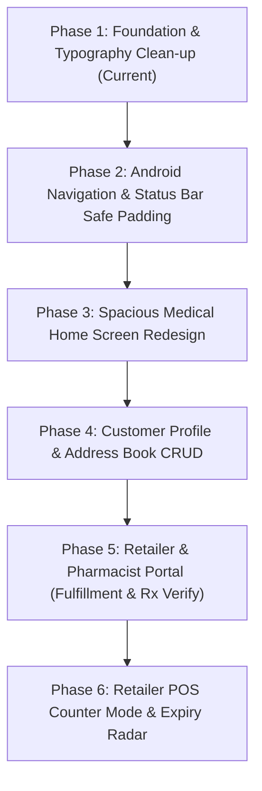

# Medical SaaS Platform — Gap Analysis, Feature Audit & Implementation Roadmap

> **Audit Scope**: Comprehensive evaluation comparing `Medical_backend/` (Express, Prisma, PostgreSQL), `medical_frontend/` (Next.js 14 Web Application), and `MedicalApp/` (React Native Mobile Application).

---

## 1. Feature Matrix & Ecosystem Coverage

| Capability / Module | Backend API (`Medical_backend`) | Web App (`medical_frontend`) | Mobile App (`src/`) | Status & Action Required |
| :--- | :---: | :---: | :---: | :--- |
| **Customer Auth (Login, Register, OTP, Reset)** | ✅ Yes (`/auth/*`) | ✅ Yes (`/login`, `/register`, etc.) | ✅ **Completed** | Full parity achieved with Redux persistence. |
| **Store Geo-Discovery & Nearby Filtering** | ✅ Yes (`/customers/stores/nearby`) | ✅ Yes (`/stores`) | ✅ **Completed** | Fully wired with latitude/longitude/radius queries. |
| **Medicine Search & Live Debouncing** | ✅ Yes (`/customers/products/search`) | ✅ Yes (`/search`) | ✅ **Completed** | Supports brand name and salt search. |
| **Generic Substitute Comparison** | ✅ Yes (`isGeneric`, generic mapping) | ✅ Yes (Substitutes banner) | ✅ **Completed** | Side-by-side cost saving UI implemented. |
| **Drug-Drug Clinical Safety Engine** | ✅ Yes (`/safety/check-interactions`) | ✅ Yes (Safety alerts in cart) | ✅ **Completed** | Validates cart interactions (`SEVERE` vs `MODERATE`). |
| **Cart Operations & Single-Store Rules** | ✅ Yes (`/customers/cart`) | ✅ Yes (`/cart`) | ✅ **Completed** | Multi-store 409 conflict modal + flat item mapping. |
| **Checkout & Slot Scheduling** | ✅ Yes (`/customers/orders` POST) | ✅ Yes (`/checkout`) | ✅ **Completed** | Mandatory Rx validation, Pickup Date & Slot selector. |
| **Order History & Real-Time Tracking** | ✅ Yes (`/customers/orders/:id`) | ✅ Yes (`/orders/[id]`) | ✅ **Completed** | Stepper lifecycle tracking, cancellation & invoices. |
| **Customer Address Management** | ✅ Yes (`/customers/addresses`) | ✅ Yes (`/profile`) | ⚠️ **Partial** | Needs full CRUD address sheet in Mobile Profile. |
| **Prescription Camera / File Upload** | ✅ Yes (`/prescriptions/upload`) | ✅ Yes (Web file input) | ⚠️ **Partial** | Uses mock URL picker; needs native camera/document picker. |
| **Retailer POS Counter Billing** | ✅ Yes (`/pos/*`, `/inventory/*`) | ✅ Yes (`/retailer/pos`) | ⏳ **Roadmap Phase 5** | Tablet/Phone POS counter mode for pharmacy shop owners. |
| **Retailer Order Queue & Rx Approval** | ✅ Yes (`/orders/retailer/*`) | ✅ Yes (`/retailer/orders`) | ⏳ **Roadmap Phase 5** | Pharmacist review dashboard to approve/reject Rx. |
| **Inventory Batch Expiry Alerts (FEFO)** | ✅ Yes (`/inventory/*`) | ✅ Yes (`/retailer/inventory`) | ⏳ **Roadmap Phase 6** | 30/60/90 day expiry radar for retail chemists. |
| **Distributor Wholesale Procurement (B2B)** | ✅ Yes (`/purchases/*`, `/vendors/*`) | ✅ Yes (`/retailer/purchases`) | ⏳ **Roadmap Phase 7** | Purchase Order creation & goods receiving. |

---

## 2. UI/UX Identified Issues & Immediate Corrections

### Issue 1: Poppins Font Fallback on Android (System Roboto Appearing)
- **Problem**: In multiple `.style.ts` files, styles defined both `fontFamily: font.bold` (which is `Poppins-Bold`) **and** `fontWeight: '700'`.
- **Root Cause**: On Android, React Native font resolver tries to find a font variant named `Poppins-Bold_700` or `Poppins-Bold_bold`. When that file doesn't exist, it falls back to Android's default system font (Roboto), making text look misaligned, non-custom, and unrefined.
- **Correction**: Strip all redundant `fontWeight` attributes from all `.style.ts` files where a specific Poppins font family is declared.

### Issue 2: Android 3-Button Navigation Bar Overlap
- **Problem**: On Android devices using the 3-button navigation bar (Back, Home, Recent Tasks), the bottom tab bar and bottom screen buttons (like "Don't have an account? Create Account" on Login) were partially cut off or hidden behind the system bar.
- **Root Cause**: Non-translucent status/navigation bar configurations don't yield proper inset values through `react-native-safe-area-context` when windows are not drawing under system decor.
- **Correction**:
  - Add explicit platform safety padding on `BottomTab` (`Math.max(insets.bottom, 16)` on Android).
  - Wrap Login, Register, Forgot Password, and other root screens with a dedicated `KeyboardAvoidingView` + `SafeAreaView` with bottom insets to ensure buttons float comfortably above Android buttons.

### Issue 3: Congested Home Screen ("Mix Congested")
- **Problem**: Elements on the Home screen felt crowded together, with little breathing room between the search bar, prescription card, and store list.
- **Correction**:
  - Implement 20dp section spacing.
  - Create a clean, elegant **Top Healthcare Bar** with user's selected address and subtle notification/cart pills.
  - Prominent, hospital-grade **Pill Search Bar** with high-contrast icon and subtle shadow.
  - Dedicated **Doctor's Prescription Upload Banner** with clinical teal icon, clear value proposition ("Order with Prescription — Our licensed pharmacist will verify and dispense"), and an upload button.
  - Horizontal scroll of **Health Concerns / Therapeutic Specialties** (Diabetes, Cardiology, Pain Relief, Stomach & Digestion, Immunity Boosters, Derma Care) with clean pill badges.
  - Clean **Partner Pharmacies Section** with pharmacy license status, verified badges, open/close indicators, and clear CTA.

---

## 3. Step-by-Step Implementation Roadmap

### Phase 1: Foundation & Typography Clean-up (Immediate)
1. Add `react-native.config.js` with assets mapping to `./src/assets/fonts/`.
2. Clean all `.style.ts` files to remove conflicting `fontWeight` declarations.
3. Verify that `Poppins-Regular`, `Poppins-Medium`, `Poppins-SemiBold`, and `Poppins-Bold` are cleanly recognized.

### Phase 2: Android Navigation & Status Bar Safe Padding (Immediate)
1. Ensure `BottomTab` provides ample bottom clearance (minimum 20dp padding on Android).
2. Fix `Login`, `Register`, `Forgot`, `Cart`, `Checkout` bottom button safe zones.
3. Configure crisp dark status bar icons on white background.

### Phase 3: Spacious Medical Home Screen Redesign (Immediate)
1. Restructure `StoreDiscovery.tsx` and `storeDiscovery.style.ts` into distinct, airy sections.
2. Provide informative empty states and error recovery states with doctor/pharmacy illustrations.
3. Ensure fluid scrolling with pull-to-refresh.

### Phase 4: Customer Profile & Address Management
1. Complete address list, Add New Address form with GPS coordinates.
2. Prescription history manager (view past uploaded Rx slips).

### Phase 5: Retailer Mode (Pharmacist Mobile Portal)
1. Role-based view switch for Retail Pharmacy staff.
2. Order fulfillment dashboard: inspect prescription image, approve/reject with notes, mark packed.
